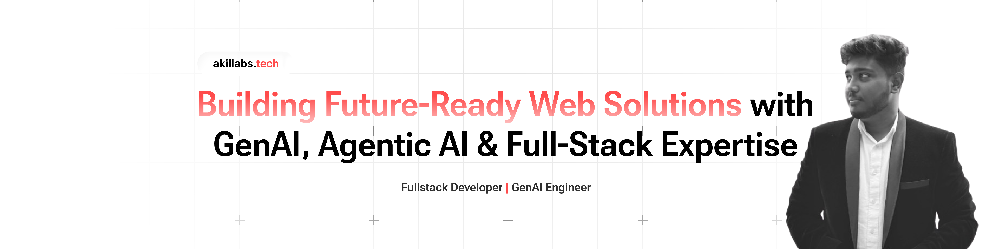

 

<h3>Hi there, I'm Akil A 👋</h3>

<b>AI & Full-Stack Developer</b> specializing in <b>GenAI, LLMs, and Scalable Web Apps</b>. 
Currently solving complex <b>Agentic AI problems</b> and building autonomous multi-agent workflows.

 

---

